# Project Nexus

**An AI Agent Lifecycle Manager that keeps local AI coding agents installed, configured, healthy, and ready to work.**

Nexus is a local-first desktop app for macOS (Windows support is implemented but not yet validated). It looks after the coding agents you already use — **OpenAI Codex, Claude Code, Gemini CLI and OpenCode** — and tells you, with evidence, whether each one is ready. When something is wrong it explains why and offers a safe, previewed, verified fix. It never replaces your agents, never runs scripts from the internet, and never touches your credentials.

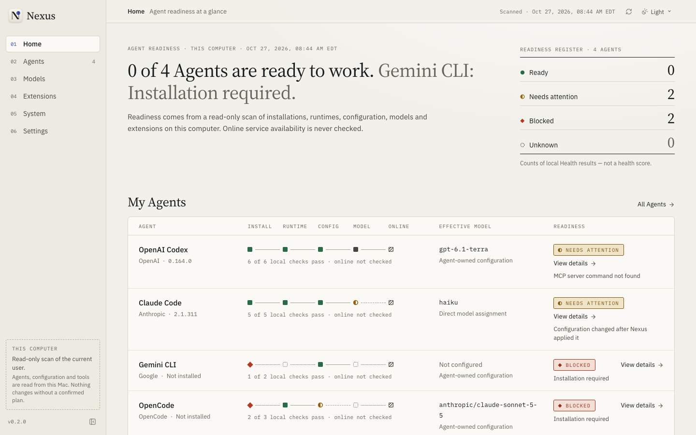

> **Status: 0.2.0-beta.1 pre-release — Core Backend Beta Candidate.** Validated on macOS (Apple Silicon). Windows code paths exist but have not been built or tested. The pre-release DMG is ad-hoc signed and **not notarized**. See [Known limitations](#known-limitations).

## Contents

- [Why Nexus](#why-nexus)
- [Features](#features)
- [Supported agents](#supported-agents)
- [How changes stay safe](#how-changes-stay-safe)
- [Install](#install)
- [Build from source](#build-from-source)
- [Architecture](#architecture)
- [Testing](#testing)
- [Known limitations](#known-limitations)
- [Documentation](#documentation)
- [License](#license)

## Why Nexus

Running several AI coding agents means juggling different installers, config formats (TOML, JSON, JSONC), model settings that can be overridden by environment variables, MCP servers that silently fail to start, and duplicate installs where the wrong copy runs first. Nexus turns that into one calm answer per agent — **Ready, Needs attention, Blocked, Unknown or Unsupported** — backed by the exact evidence it observed.

Design principles:

- **Agents first.** Nexus manages agents; it does not replace them or become another chat client.
- **Evidence, not guesses.** Health is deterministic and explains its coverage. Missing or stale evidence is reported as *Unknown*, never as *Ready*.
- **Read-only by default.** Discovery never writes, installs, authenticates, sources your shell profile or starts MCP servers.
- **Every change is a confirmed plan.** You see the exact diff or command before anything happens, confirm it in a native system dialog, and Nexus verifies the result independently.
- **Local-first.** No account, no cloud, no telemetry. Works offline.

## Features

### Home — readiness at a glance

The readiness register counts agents by state (never a health score). Each agent row shows a five-step **readiness path** — Install → Runtime → Config → Model → Online — with the number of local checks that passed, the effective model and the top finding. Online service availability is always shown as *not checked*, because routine Health makes no network calls.

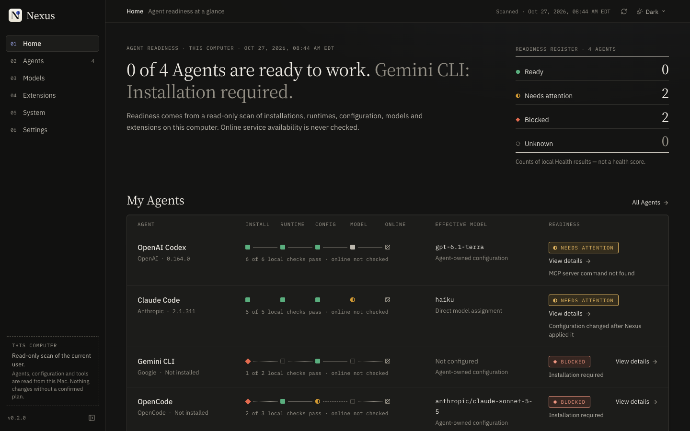

### Agent discovery

For each agent Nexus finds, without changing anything:

- every installation in your `PATH` **and** in well-known install locations (apps launched from Finder have a shorter `PATH` than your terminal), with the one that runs first marked;
- the installed **version** and where that fact came from — package manifest, install layout, or a reviewed `--version` probe (5 s timeout, empty environment, never run on scripts or untrusted locations);
- the **install source**: npm, Homebrew, native installer, vendor script, WinGet or unknown;
- configuration files (user, managed/system, agent state) and whether each one parses;
- login evidence — **presence only**; credentials are never read;
- MCP servers, Skills, environment variables and shell-profile exports that override settings.

### Agent detail

Each agent has five tabs: Overview, Model, Extensions, Configuration and Diagnostics. The header shows identity, readiness, install source, version and when the evidence was observed, followed by the expanded readiness path.

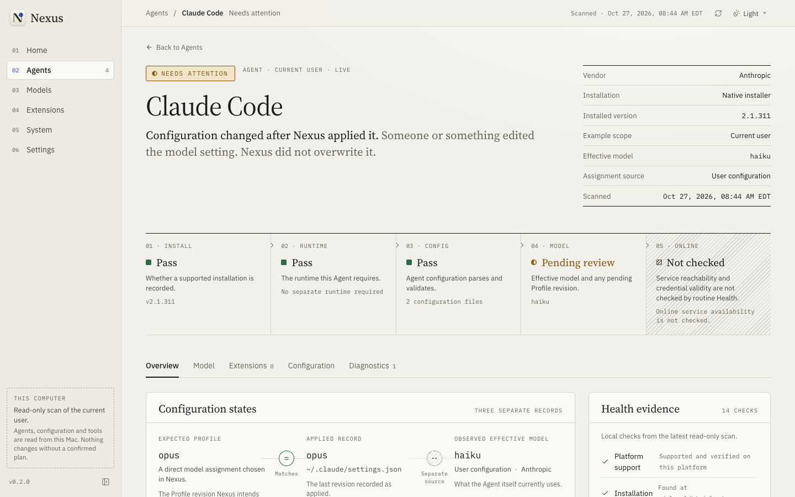

### Deterministic Health and structured Diagnostics

Health (`nexus-readiness-1`) evaluates installation, executability, version, runtime prerequisites (for example Gemini CLI needs Node.js 20+), configuration validity, duplicate installs, authentication evidence, model compatibility and drift, environment overrides, MCP commands and Skill metadata. Each finding states the observed versus expected condition, user impact, whether the cause is *established* or only *possible*, when the evidence was observed, and either a trusted repair or manual guidance.

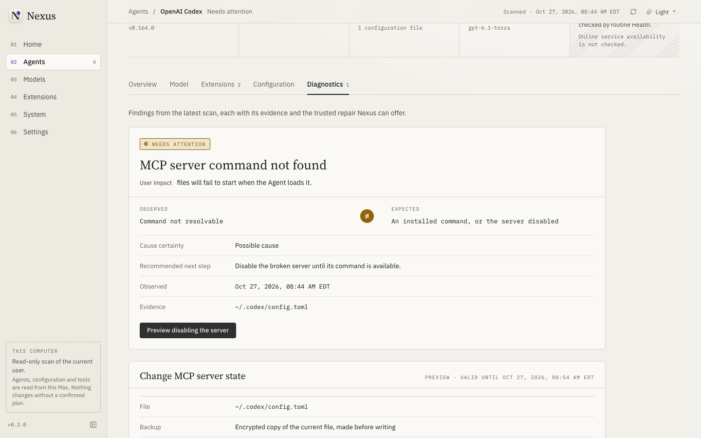

### Safe Repair

Repairs are registered actions, never generated commands:

| Repair | When it is offered |
| --- | --- |
| Restore a known-good backup | A configuration file is malformed and Nexus holds an encrypted backup of it |
| Reapply a model assignment | Your configuration was changed after Nexus applied a model |
| Recover an interrupted installation | Nexus was closed or crashed during an install; it reconciles first and never replays blindly |
| Disable a broken MCP server | A server's command cannot be found |

Before you confirm, Nexus shows the exact plan: the file, the precise lines that change, backup and rollback behaviour, privileges, warnings and what is preserved.

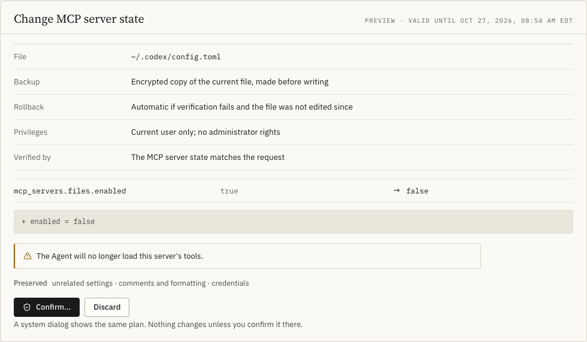

Confirming opens a native macOS dialog built by the Rust backend from the same plan, so the web view cannot approve anything on its own. Afterwards Nexus re-reads the system and reports each verification check.

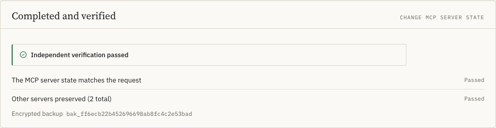

### Models and Providers

Provider, Model, Model Profile and Agent assignment are separate records, shown left to right as an assignment chain.

- **Catalog:** built-in aliases with recorded provenance, models already found in your agent configs, and models you add manually (their capabilities stay *unknown*).
- **Model Profiles** are revisioned; editing creates a new revision, and applied agents keep the revision they were verified with.
- **Assignments** track *desired* (saved in Nexus), *applied* (written and verified) and *effective* (what the agent actually uses) separately.
- **Custom OpenAI-compatible endpoints** can be added (HTTPS, or `http://localhost`), with API keys stored only in the macOS Keychain.

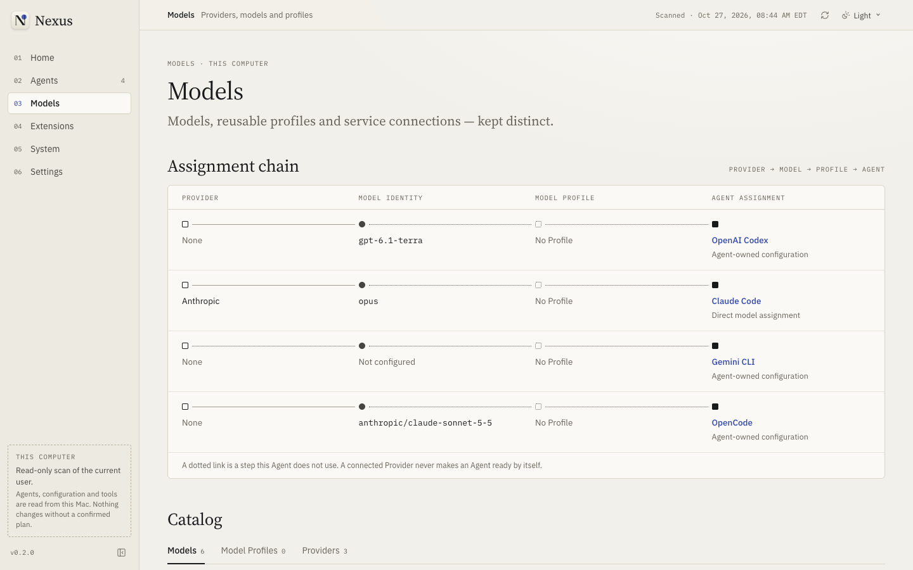

The Model tab explains **where the effective model comes from**, highest priority first — for example an `ANTHROPIC_MODEL` environment variable outranks `~/.claude/settings.json` — so an override never looks like a failed change.

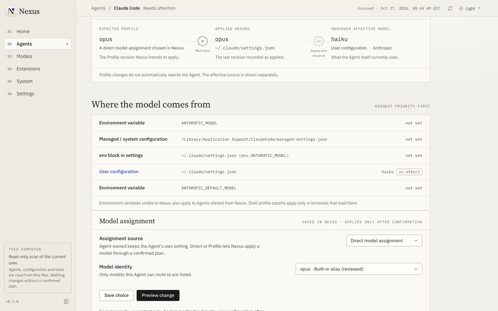

### Extensions: MCP and Skills

Nexus lists every MCP server configured for each agent, showing transport, command name or origin only (never arguments or secrets), and lists Skills. It never starts a server or runs a Skill. Where supported, you can enable or disable a server, add a remote HTTPS server, or remove servers Nexus itself added. Entries you created are shown but never deleted.

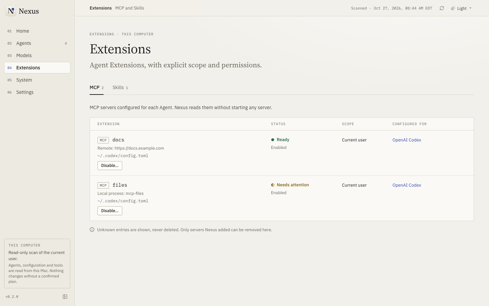

### Configuration, lifecycle and backups

The Configuration tab lists installations (with **Open in Terminal**, **Update** and **Uninstall** where a vetted recipe applies), configuration sources, authentication evidence, a per-agent capability matrix explaining anything unsupported, and encrypted configuration backups with restore.

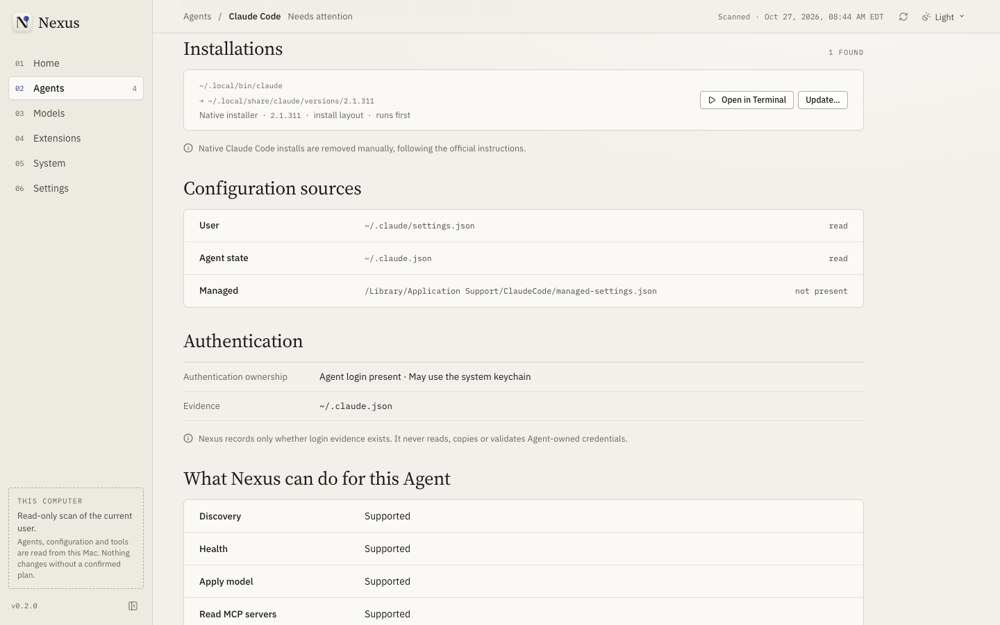

Lifecycle operations use compiled recipes only: **npm** (exact version pinned before you confirm, addressed through the installation's own npm prefix), **Homebrew**, and Claude Code's own `claude update`. Vendor `curl | sh` installers are never executed. Uninstalling removes the program and keeps your configuration, credentials and shared runtimes.

### System

OS version, architecture, Node.js, npm, Git, Python and Homebrew with versions and locations, which agents depend on each tool, the directories searched, and where Nexus keeps its own data.

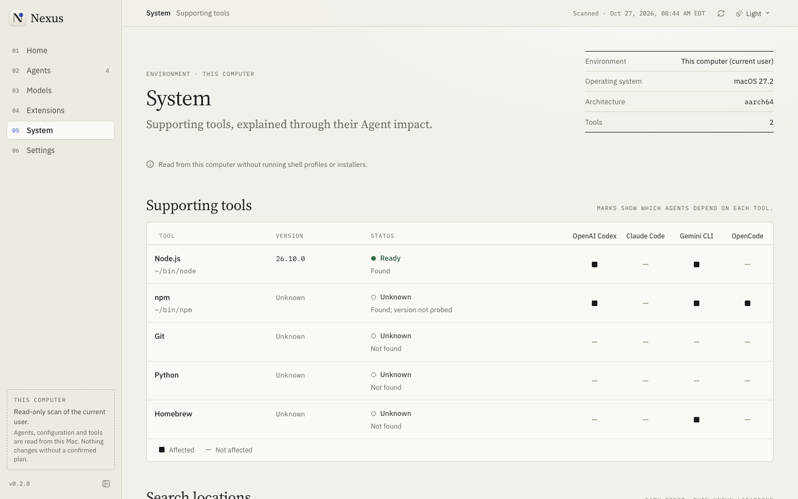

## Supported agents

macOS is verified on Apple Silicon; Windows is implemented but unverified.

| Capability | OpenAI Codex | Claude Code | Gemini CLI | OpenCode |
| --- | --- | --- | --- | --- |
| Discovery and Health | ✅ | ✅ | ✅ | ✅ |
| Apply model | ✅ `model` (TOML) | ✅ `model` (JSON) | ✅ `model.name` | ✅ `model` (blocked if both `opencode.json` and `.jsonc` exist) |
| Provider routing (agent's own login) | OpenAI | Anthropic | Google | Anthropic, OpenAI, Google |
| Read MCP servers | ✅ | ✅ | ✅ | ✅ |
| Enable/disable, add remote, remove Nexus-added MCP | ✅ | — (Claude owns `~/.claude.json`) | ✅ | ✅ |
| Skills | Read | Read | Read | Read |
| Install | npm, Homebrew | Homebrew, npm | npm, Homebrew | npm |
| Update | npm, Homebrew | npm, Homebrew, `claude update` | npm, Homebrew | npm |
| Uninstall | npm, Homebrew | npm, Homebrew | npm, Homebrew | npm |
| Launch in Terminal | macOS | macOS | macOS | macOS |

Full evidence, sources and dates: [backend implementation record](docs/BACKEND_IMPLEMENTATION_PROGRESS.md).

## How changes stay safe

1. **Typed request.** The UI can only ask for one of nine registered actions; inputs are validated in Rust and unknown fields are rejected.
2. **Immutable plan.** Rust computes the exact change, bound to a fingerprint of the current file, a digest, and a 10-minute expiry. A plan can be used once.
3. **Native confirmation.** The OS dialog is created by Rust from the plan; there is no “confirmed: true” the web view could forge.
4. **Protected backup.** Before an existing file is changed, an exact copy is encrypted (AES-256-GCM, key in the Keychain) and verified.
5. **Minimal, atomic write.** Only the targeted key changes; comments, ordering and unrelated settings are preserved. Symlinked, hard-linked, foreign-owned or world-writable targets are refused, and the file is re-checked for concurrent edits right before replacement.
6. **Independent verification.** Nexus re-reads the system. A successful exit code alone is never success.
7. **Honest recovery.** If verification fails, Nexus rolls back only if nobody else has edited the file since; otherwise it says so and keeps the backup available.

Secrets live only in the macOS Keychain. They are never stored in the database, logs, IPC responses or diagnostics; tokens in process output are redacted. The renderer has no shell, filesystem, HTTP or dialog permissions. Threat model: [docs/SECURITY.md](docs/SECURITY.md).

## Install

Download the pre-release from [Releases](https://github.com/Sun-sh902/Project-Nexus/releases) (Apple Silicon DMG) and check its SHA-256 against the attached `.sha256` file.

The build is ad-hoc signed and **not notarized**, so macOS blocks the first launch. After reviewing the source, Control-click the app and choose **Open**. Do not use pre-release builds where you cannot accept that risk.

Nexus stores its own data (SQLite database and encrypted backups) in `~/Library/Application Support/dev.projectnexus.desktop/`.

## Build from source

Prerequisites: Node.js 26+, the pnpm version pinned in `package.json`, stable Rust, and the [Tauri prerequisites](https://v2.tauri.app/start/prerequisites/) (on macOS, the Xcode Command Line Tools).

```sh
pnpm install --frozen-lockfile
pnpm desktop:dev        # run the desktop app with live data from this computer
pnpm desktop:build      # release build: src-tauri/target/release/bundle/
```

`pnpm dev` serves the UI in a browser at http://127.0.0.1:1420. There is no native backend there, so it shows a clearly labelled demo using fixed sample data. Run `dev` and `desktop:dev` separately; they share a port.

## Architecture

A single Tauri 2 desktop app: a React + TypeScript UI and a Rust backend in `src-tauri/src`.

| Module | Responsibility |
| --- | --- |
| `discovery/` | Read-only agent and system discovery with a probe trust policy |
| `adapters/` | One compiled adapter per agent; model and MCP editing are optional capabilities |
| `health.rs`, `diagnostics.rs` | Pure, deterministic Health rules and structured findings |
| `actions.rs` | Action Registry: plans, native confirmation, journaled execution, verification, compensation |
| `config/` | Format-preserving JSON/JSONC/TOML edits, transactions and rollback |
| `lifecycle.rs` | Vetted npm/Homebrew recipes with pinned versions |
| `models.rs`, `store.rs` | Providers, Models, Profiles, assignments; SQLite with versioned migrations |
| `secrets.rs`, `backup.rs` | Keychain-only secrets; encrypted backups |
| `platform/` | Bounded file reads, atomic writes, the single shell-free process runner |
| `ipc.rs` | 14 typed commands, each allowlisted for the main window only |

The UI keeps all copy in `src/locales/en-US` and reads data through one provider (`src/app/nexus-data.tsx`). See [docs/ARCHITECTURE.md](docs/ARCHITECTURE.md).

## Testing

```sh
pnpm typecheck && pnpm exec eslint src tests scripts
pnpm test                # unit tests (Vitest)
pnpm test:ui             # UI tests (Playwright, installed Google Chrome, axe accessibility)
pnpm native:test         # Rust tests, including end-to-end scenarios on isolated fake homes
cargo clippy --locked --manifest-path src-tauri/Cargo.toml --all-targets -- -D warnings
pnpm screenshots         # regenerate the README screenshots
```

The Rust scenario tests build throwaway home directories with fake agents and a fake npm, so they never touch your real agents or configuration. Opt-in checks: `cargo test real_machine -- --ignored` (read-only scan of this computer) and `cargo test keychain_selftest -- --ignored` (real Keychain round trip, cleaned up afterwards).

## Known limitations

- **Windows**: implemented but not built or validated; Windows npm recipes are inactive.
- **No online checks**: Provider reachability, credential validity and remote model lists are not checked.
- **Custom endpoints** can be stored but not assigned to agents, because no supported agent can receive a key without writing it in plain text.
- **Skills** are read-only. Nexus does not add local-process (stdio) MCP servers or edit Claude Code's MCP servers.
- Removing a JSONC entry can drop an adjacent comment line.
- The pre-release DMG is not notarized.

## Documentation

- [Product requirements](docs/PRD.md) and [roadmap](docs/ROADMAP.md)
- [Architecture](docs/ARCHITECTURE.md) and [security / threat model](docs/SECURITY.md)
- [Design system](docs/DESIGN_SYSTEM.md) and [language and copy](docs/I18N.md)
- [Agent Manifest specification](docs/AGENT_MANIFEST.md)
- [Backend implementation record](docs/BACKEND_IMPLEMENTATION_PROGRESS.md) — capability evidence, tests, review findings
- [Changelog](CHANGELOG.md) and [engineering constitution](AGENTS.md)

## License

Licensed under the [Apache License 2.0](LICENSE). Bundled fonts in `public/fonts/` are distributed under the SIL Open Font License 1.1, with license and provenance files next to them. Project Nexus is an independent project, not affiliated with OpenAI, Anthropic, Google or the OpenCode project; agent names identify the tools Nexus manages.

Security issues: please use GitHub private vulnerability reporting on this repository rather than public issues.
