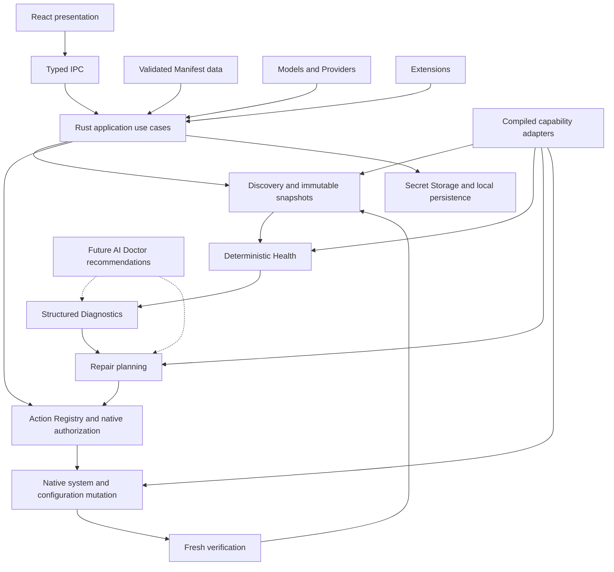

# Project Nexus architecture

Status: canonical Phase 0 design, 2026-10-07. No interfaces below are implemented. [PRD](PRD.md) owns scope; [ROADMAP](ROADMAP.md) owns sequencing. Security-sensitive behavior must also satisfy [SECURITY](SECURITY.md).

## 1. System overview

Use a modular desktop application, not microservices or a downloadable plugin runtime. Logical boundaries do not mandate separate crates, packages, processes, or repositories. Introduce physical separation only when implementation and tests justify it.

AI recommendations are untrusted inputs. The Action Registry independently validates all plans. Manifest data can select an existing capability only within shipped native policy; it cannot add executable behavior.

## 2. Stack and responsibility boundaries

Tauri 2 hosts a Rust native backend and React/TypeScript/Vite frontend. Tailwind consumes semantic tokens; selectively use Radix UI or shadcn/ui primitives with Nexus styling. i18next/react-i18next own localization. Zustand is optional for shared view preferences, not a second backend database. TanStack Query is optional for native asynchronous data caching/invalidation. SQLite is introduced when durable domain records and operation journals require it. Secure storage targets macOS Keychain and Windows Credential Manager. No cloud or Supabase dependency in MVP.

| Boundary | Owns | Must not own |
| --- | --- | --- |
| Frontend Presentation | Navigation, forms, accessible rendering, translations, safe previews, user intents | Shell, raw filesystem, credentials retrieval, authoritative compatibility/security decisions |
| Application / Use Case | Workflow orchestration, immutable plans, operation IDs, cancellation, consistency | Agent-specific file formats or UI layout |
| Native System | Processes, file handles, platform paths, bounded networking, package-manager invocation | Product positioning or unrestricted IPC utilities |
| Agent Capability Adapter | Version-aware detection, effective config, mapping Models/Extensions, Agent-specific checks | UI components, unrestricted dynamic code loading |
| Discovery | Observations and provenance with bounded probes | Repairs, installs, implicit authentication, shell-profile execution |
| Health | Pure rule evaluation over snapshots | AI, mutations, direct network/process calls |
| Diagnostics | Findings connecting issues, evidence, causes, and eligible repairs | Terminal transcript as the explanation or automatic execution |
| Repair | Plan construction, policy eligibility, verification/compensation specification | Arbitrary commands or promises of universal rollback |
| Model / Provider | Connection schemas, model identity/metadata, profiles, assignments, compatibility | A global universal credential format or model option bag |
| Extension | MCP/Skill identity, source, scope, compatibility, permission disclosures | Executing content during discovery; premature marketplace |
| Installer | Trusted install/update/uninstall recipes and ownership records | A remote shell script executor |
| Manifest | Versioned validated metadata and strategy selection | New native permissions or adapters |
| Action Registry | Typed action definitions, argument policies, authorization, execution dispatch | Blind trust in a frontend confirmation boolean |
| Configuration Mutation | Preservation, preconditions, backup, minimal patch, atomic replacement, recovery | Lossy serialization or automatic conflict resolution |
| Secret Storage | Opaque references, secret lifecycle, bounded handoff | Plaintext fallback or secrets in SQLite |
| Persistence | Local preferences, nonsecret domain data, operation journals, schema migration later | Replacing external config as the observed truth |
| Future Workspace | Project/context associations using existing IDs | Early project database/framework |

## 3. Typed IPC and operation lifecycle

Use explicitly named queries and intents, such as `discover_agents`, `get_agent_health`, `preview_model_assignment`, `prepare_repair`, and `confirm_plan`. Names are conceptual, not a committed API. Inputs use bounded enums and identifiers. Native code resolves target paths/executables; a UI-supplied string is never a general path or command authority.

Responses carry a versioned envelope: request ID, result or stable error code, safe typed parameters, retryability, and optional operation ID. Dates use UTC instants; paths use opaque target IDs with separately redacted display labels. Rust is the authority for validation, capabilities, and effective state.

Long operations publish sanitized progress with operation ID and monotonically increasing sequence. Reconnecting UI retrieves a snapshot and ignores duplicate/out-of-order events. Cancellation is a request, honored only at safe checkpoints; noninterruptible steps show that fact. IPC rejects unknown fields/actions, oversize payloads, invalid references, stale plans, and unauthorized windows/origins. Tauri capabilities are defense in depth, not a substitute for validating custom Rust commands. See [Tauri capabilities](https://v2.tauri.app/security/capabilities/).

Mutations follow `prepared → awaiting_confirmation → executing → verifying → succeeded | failed | partial | cancelled`; recovery may additionally record `rolled_back` or `rollback_failed`. `cancelled` describes work stopped, not proof that nothing changed. The journal records exact completed steps. Confirmations bind plan digest, targets, resource revisions, privileges, expiry, and allowed actions; a replay cannot execute twice. For sensitive/elevated changes, use an OS/native-owned confirmation boundary as specified in Security.

## 4. Agent identity and capability adapters

Separate a catalog `AgentId` from a discovered `AgentInstallationId`. One Agent can have multiple package-manager or native installations. Installation identity includes host execution environment (native macOS/native Windows; future WSL distinct), canonical executable identity, architecture, installation source, and ownership confidence. Adopt means create a Nexus association, not take ownership of files or credentials.

Compile first-party adapters into Nexus. A versioned capability descriptor exposes only supported operations and structured option schemas. Runtime resolution intersects Manifest declaration, compiled adapter support, detected Agent version, platform, and local policy. A remote claim never broadens this intersection.

| Capability | Contract |
| --- | --- |
| AgentDetector | Enumerate candidates and observations without changing them; identify ambiguity/provenance |
| AgentLifecycle | Separate optional install/update/uninstall/launch capabilities; prepare recipes and verify outcomes |
| AgentConfigAdapter | Locate applicable sources, parse preserving unknown content, explain precedence, prepare minimal supported changes |
| ModelTarget | Validate a resolved Model/Profile and map only supported options/authentication modes |
| ExtensionTarget | Separate MCP and Skills, each with scope and operation support; preserve native permissions |
| AgentHealthContributor | Supply version-qualified pure check definitions and evidence requirements |

No giant mandatory interface and no fake “success” for unsupported methods. Return `unsupported` with reason/version/platform requirements. Unknown Agent versions may retain safe discovery while disabling unvalidated mutation. Keep fixture examples of config precedence and package identities next to the future adapter implementation, with official source/date evidence.

## 5. Discovery and System

`SystemSnapshot` contains OS/version/architecture, execution environment, known shell, scoped PATH observations, and discovered runtime/tool facts. Candidate tools include Node.js, npm, Git, Python, Homebrew on macOS, and WinGet on Windows. Absence is only an Agent blocker if an applicable capability requires the tool.

`AgentSnapshot` contains installation identity, observed version, executable provenance, configuration revision/fingerprints, effective model/authentication metadata, extension observations, environment-conflict indicators, and timestamps. No raw credentials, entire environment dump, or arbitrary config document crosses IPC.

Each observation records value or explicit unknown, source, observedAt, validity/freshness policy, probe version, and failure classification. Separate `not_found`, `access_denied`, `timeout`, `parse_failed`, and `not_checked`. Filesystem existence alone does not prove installation or executability. Multiple candidates remain visible.

Phase 2 uses bounded metadata reads and reviewed native probes. Never source shell rc files, invoke package-manager installs, start MCP servers, execute Skills, or run an arbitrary PATH candidate merely to ask its version. Native policy validates candidate identity first; if it cannot, report unverified and require a separately approved probe. Commands with startup hooks or telemetry side effects require explicit analysis; “read-only” is an intended effect, not proof of safety. Limit probe concurrency, time, output, and directories scanned. No home-directory recursive crawl.

Refresh relevant snapshots after actions, watched-file changes, environment/context changes, and manual refresh. Coalesce repeated checks, avoid indefinite polling, and show stale last-known evidence. Remote checks are separately scoped, bounded, and opt-in when they send credentials; routine health makes no paid model inference requests.

## 6. Agent Health

`HealthCheck`: stable ID, rule version, capability/Agent applicability, required evidence, requirement level (`required` or `advisory`), outcome (`pass`, `fail`, `unknown`, `not_applicable`), evaluatedAt, and evidence references. A failed required check is blocking; a failed advisory check is a warning. Reject rule definitions that assign the opposite impact, so aggregation has no undefined case. A missing required capability is not `not_applicable` just to obtain green status.

`HealthIssue`: stable check/installation/context identity, severity, impact, evidence references, first/last observed time, and lifecycle (`active`, `resolved`, `stale`). `AgentHealth`: scoped aggregate, check coverage, rule-set version, snapshot IDs, evaluatedAt, and validUntil. No opaque numeric health score.

Aggregation order is normative:

1. `unsupported`: the selected platform/Agent context cannot be supported; provide exact limitation. Installation state is separate, so a missing Agent is normally blocked, not unsupported.
2. `blocked`: at least one fresh required check proves a blocking failure.
3. `unknown`: any required evidence is missing, stale, denied, timed out, or invalid, with no proven blocking failure. Retain prior failures as last-known evidence, never fresh fact.
4. `attention`: required checks pass, but fresh non-blocking warnings exist. Advisory unknowns appear as coverage limitations and do not alone change this state.
5. `ready`: all applicable required checks freshly pass and no fresh warnings remain. Always show coverage; optional network reachability may be untested.

`checking` and `repairing` are operation overlays, not replacements for stored health truth. Health is evaluated for a declared execution/configuration context; MVP defaults to current-user native configuration. Project-specific claims require an explicitly supplied context later.

Relevant check families: installation/binary/version/runtime/prerequisites/config validity/Provider credential availability/Model compatibility/environment conflicts/Extensions. A mere update available is ordinarily informational, not a blocker. A Provider timeout is not proof of invalid credentials or unavailable Model. A Model list omission is not proof of an invalid identifier. A locked credential store is a distinct condition from deleted authentication.

Phase 3 establishes the engine and installation/runtime/config-read checks. Phases 5 and 6 supply richer Model/Extension evidence; the initial engine reports deferred areas as not checked. Thus Phase 3 does not depend on implementing future domains. Equal snapshots, rules, and evaluation time produce equal results. Test the clock and freshness explicitly.

Before Phase 7, freeze a versioned readiness policy per supported Agent/context defining all applicable local requirements, including configuration/authentication/Model compatibility and enabled Extension validity. Interim Phase 3 coverage is labeled limited; it cannot be reused as the final Beta policy by omitting unfinished domains. Optional online service reachability remains distinct from local readiness and always has its own unknown/stale label.

## 7. Structured Diagnostics

`DiagnosticFinding` contains stable finding ID/rule version, AgentInstallationId/context, originating HealthIssue IDs, severity, localized summary key, redacted evidence references, expected state, observed state, user impact, cause status (`established` or `possible`), and eligible trusted action IDs.

Findings prioritize Agent impact and distinguish symptoms from confirmed causes. One System problem can reference multiple affected Agents without flooding Home. Logs are bounded supporting evidence beneath the explanation. Do not present guessed causes as facts. A finding may have no automated repair and provide safe manual guidance instead.

Health may surface basic issue text before Phase 7. The complete finding-to-repair workflow ships in Phase 7, avoiding a contradictory earlier Beta boundary.

## 8. Safe Repair and lifecycle actions

`RepairAction` is a compiled Action Registry definition with typed parameters, eligibility, side effects, risk, privilege needs, resource locks, backup policy, execution implementation, postconditions, cancellation points, and compensation limits. It is not a command string.

`RepairPlan` has immutable ID/revision/digest, findings, Agent targets, ordered action instances, preconditions/fingerprints, impact, exact configuration diff, credential destinations, backup strategy, verification requirements, rollback availability, and confirmation expiry. Plan creation itself must not mutate Agent files or expose secrets.

HealthIssue → DiagnosticFinding → RepairPlan → trusted RepairAction → explain impact → backup where appropriate → explicit user confirmation → execute → verify → rollback when possible.

Backup planning precedes confirmation. An actual protected backup may be staged during preparation only with the user's existing access authorization; otherwise create it immediately after confirmation and before the first write. If backup fails, stop. This preserves the conceptual flow without silently copying sensitive files during browsing.

`RepairResult` records each action outcome, changed resources, recovery references, and `VerificationResult`. Verification has independent postcondition outcomes (`passed`, `failed`, `inconclusive`, `not_run`) with fresh evidence. A success exit code with an inconclusive postcondition remains unverified; the Agent does not become Ready by fiat.

Before execution, re-read target identities/config revisions and revalidate plan eligibility. Per-resource locks prevent Nexus conflicts; external edits are still possible and require optimistic conflict checks. Multi-Agent/profile plans are a sequence of independently journaled operations, not a fictitious distributed transaction. Stop on failed preconditions, show completed changes, and offer a fresh plan for remaining work.

Rollback occurs only if the plan disclosed it, target state still matches the operation's output, and reversal is safe. An external edit prevents blind restore. Irreversible installer effects need explicit recovery guidance. Retry reconciles observed state first; it must not replay package-manager commands automatically.

A separately requested restore is different from automatic compensation: it creates a new plan bound to the current file fingerprint, identifies the selected known-good backup, discloses which later changes will be replaced, protects the current bytes, and requires fresh confirmation. A malformed current file cannot be minimally merged, but may be restored through this dedicated action if backup provenance, target identity, restored syntax/semantics, and execution-sensitive fields can all be validated. Otherwise offer manual recovery. No inference or parser error authorizes a reset.

## 9. Models, Providers, and assignments

| Entity | Meaning and minimum conceptual fields |
| --- | --- |
| ProviderProfile | ID, displayName, providerType/protocol, validated baseURL, authentication mode/reference, typed nonsecret options, secret header references, connection observation, revision |
| ModelDefinition | Provider-scoped identity, display name, known capabilities with source/time, availability evidence, compatible protocols/options; descriptive metadata only |
| ModelReference | ProviderProfileId plus opaque provider-native model identifier; may reference a manual model with no known metadata |
| ModelProfile | ID/name/revision, ModelReference, optional supported reasoning preference and schema-qualified Provider options |
| AgentModelAssignment | AgentInstallationId/context, source mode (`native`, `direct`, `profile`), desired reference/revision, last applied revision, effective observation, compatibility result and drift |

An assignment chooses exactly one source mode. Direct mode selects a ModelReference; profile mode selects a profile and tracks desired/applied revisions; native mode preserves the Agent's existing default/authentication without synthesizing an API Provider. Provider-only selection may stage a draft but is not an executable assignment until the adapter resolves an explicit native default or ModelReference.

Model identifiers are opaque strings, not globally unique names. Protocols, model options, and authentication vary independently. A compatible endpoint does not establish that a Model supports reasoning, tool use, images, or a particular Agent. `supported`, `unsupported`, and `unknown` remain distinct compatibility states. Unknown model IDs may be saved as manual drafts; applying them requires adapter-level protocol/schema validation and clear disclosure of unverified availability. Known incompatible combinations cannot be applied.

Metadata sources: bundled reviewed seed metadata, Provider model discovery if supported, and user-entered metadata. Store provenance per assertion; manual capabilities remain user-declared, never verified. Conflicts remain visible; recent authoritative provider observations supersede older observations in the same scope, not unrelated global records. A list response establishes listing, not every capability. Refreshes never silently retarget assignments.

Model Profile editing creates a new revision. List affected Agents, validate each through ModelTarget, and preview changes. User chooses which assignments to apply. Applied revisions remain pinned until accepted; desired newer revisions show pending. Shared Provider endpoint/auth changes likewise require impact review and per-Agent reconciliation. Deletion of referenced records is restricted until references are resolved; credential removal reports resulting blocked/unknown authentication.

Every applied assignment records its resolved Provider revision, Profile revision if present, and nonsecret option snapshot. Editing a referenced Provider does not rewrite this applied snapshot or silently reroute launches; the new Provider revision is pending until reviewed/reapplied. Rotating a secret on the same approved origin is an explicit credential operation with affected-Agent disclosure, not a hidden metadata refresh.

Authentication modes include Nexus-managed secure reference, Agent-owned login, and existing environment reference where officially supported. Rust checks presence/state without exposing values. Provider tests disclose endpoint and credential destination; changing origin invalidates prior credential-routing approval. Do not send an existing key to a newly edited host silently. Secrets in custom headers use secret references; arbitrary freeform header maps are not stored as ordinary metadata.

Configuration adapters calculate desired/applied/effective differences and precedence evidence. They must detect known environment overrides without importing secret values, honor managed policy, and avoid promises about shells Nexus did not launch. Exact credential handoff is gated by secure channel support: native login, official credential store, stdin, or a scoped child environment where reviewed. Nexus does not persist API secrets in Agent plaintext configuration just to obtain compatibility. Agents requiring that workflow remain user-managed and visibly limited.

## 10. Extensions

`ExtensionDefinition` identifies type (`mcp` or `skill`), source, optional version/publisher, integrity/verification state, declared permissions, compatibility, and metadata provenance. `AgentExtensionBinding` selects installation/context, enablement, adapter-specific supported options, and observed Health. Unknown permissions or verification are shown as unknown, never safe-by-default.

MCP transport/auth and Skills layout differ per Agent. Normalize user intent, not complete vendor schemas. Remote MCP endpoints are validated, credential-scoped connections. Local stdio MCP creates an execution path even if Nexus only writes config: Beta accepts only reviewed native recipe IDs and typed arguments, never a generic pasted shell command. Existing arbitrary MCP config may be displayed redacted but is not executed or broadened by Nexus.

Skills are untrusted instructions and may bundle code. Inspect archive paths, provenance, permission claims, and target conflicts. Installation/enablement requires disclosure and confirmation; discovering or previewing never runs scripts. A verified publisher does not imply harmless content. The Agent owns runtime enforcement after launch; Nexus does not promise it can sandbox third-party behavior. No marketplace transport or remote adapters in MVP.

## 11. Installer, Manifest, and Action Registry

Potential installer families: OfficialBinaryInstaller, OfficialScriptInstaller, HomebrewInstaller, WingetInstaller, NpmInstaller, GitHubReleaseInstaller, NativePackageInstaller. They are candidate mechanisms, not seven required implementations. Official research below informs later selection.

A compiled recipe binds Agent, mechanism, package/repository identity, permitted source endpoints, supported platform/architecture/version, privilege expectations, and verification. Manifest selects a recipe plus bounded parameters. Native code pins the resolved artifact/version in the confirmed plan and checks integrity before execution. No `latest` is resolved after confirmation. Package-manager lifecycle scripts are execution risk and require vetted package identity/transitive policy. OfficialScriptInstaller is disabled until immutable reviewed bytes, digest, fixed interpreter, and secondary-download controls meet Security; live URL-to-shell piping is prohibited.

Installer ownership controls updates/uninstall. Do not switch Homebrew/npm/native channels implicitly or remove shared runtimes, user config, login, projects, or sessions by default. Use official removal semantics only after source verification. A running Agent or external auto-updater can change files; detect, reconcile, and avoid racing it.

[AGENT_MANIFEST](AGENT_MANIFEST.md) defines schema, cache, signatures, and fail-closed execution. Manifest delivery and Nexus application updates are separate trust domains. A signed Manifest is still constrained input; it is not an authorization ticket.

## 12. Configuration mutation, storage, and logs

Read → Parse → Validate → Backup → Minimal merge → Atomic write → Re-read → Validate → Rollback where practical.

The mutation layer preserves unknown keys, comments/order where supported, encoding, permissions, and unrelated scopes. Invalid or unpreservable input is read-only for ordinary edits; only the separately confirmed restore action described above may replace it. Resolve platform identity securely; reject traversal, unexpected symlinks/reparse points, unsafe ownership, and concurrent replacement. Write via a securely created sibling temporary file; flush and replace using verified platform primitives. Exact durability behavior must be proven with platform fault injection, not assumed from a shared “atomic” helper.

One-file replacement does not make multi-file changes atomic. Journal each step before side effects, include fingerprints and protected backup references, and reconcile on restart. External configuration is observed truth; SQLite holds Nexus intent and history. A commit to SQLite cannot prove Agent configuration was applied.

SQLite later stores preferences, Provider nonsecret records, Model/Profile intent, assignments, extension bindings, snapshot summaries, and minimal recovery journals. Add transactional schema migrations with version checks/backup when persistence ships, not in Phase 0. Refuse writes with an unsupported newer schema. Recover from database corruption without replacing working Agent configuration. Essential recovery history is free; longer-term history is a future product distinction.

SecretStore exposes store/replace/delete/resolve-for-action operations behind Rust. Frontend receives opaque references and availability only; secret entry is transient, cleared after submission, never restored to form state. Locked/unavailable secure storage causes a visible failure, never plaintext fallback. Credential lifecycle and orphan cleanup reconcile separately from SQLite transactions.

Errors use stable codes such as `config.concurrent_change`, `credential.store_locked`, `manifest.signature_invalid`, and `operation.verification_inconclusive`, with safe typed parameters and retryability. UI translates them; upstream error text is evidence only. Logs record operation ID/action ID/Agent ID/redacted outcome/duration. No raw environment, tokens, arbitrary config, model prompts, or process streams. Redact before persistence and IPC; see I18N for localization and Security for retention/export.

## 13. Cross-platform and failure recovery

macOS and Windows ship equivalent product intent with platform-native paths, credential stores, dialogs, keyboard conventions, process handling, permissions, and file replacement. Never concatenate POSIX paths or assume shell escaping works on Windows. Windows argument conversion, `.cmd` shims, UNC paths, drive aliases, reparse points, file locking, UAC, and case folding need separate tests. macOS bundle execution environment, package-manager prefixes, symlinks, signing/quarantine, and Apple Silicon/Intel differences need separate tests.

Nexus application requirements are separate from per-Agent/per-capability requirements. Final OS minima and supported distribution architectures remain unchosen pending official runtime guidance and packaging tests. Tauri prerequisites are a build/runtime input, not a mandate to copy another Agent's minimum: [official prerequisites](https://v2.tauri.app/start/prerequisites/).

On crash/restart, reconcile journaled operations with current resources. Show incomplete work; do not repeat it automatically. If secure storage is locked, preserve references and explain unlock. If Provider/Manifest service is offline, use policy-permitted cached metadata with freshness labels and disable unsafe mutations. Disk-full, denied access, unknown versions, and corrupt configs preserve the last known working artifacts wherever possible.

## 14. Testing boundaries and decisions

Pure tests: Health aggregation/freshness, compatibility, profile revision resolution, finding eligibility. Fixture/contract tests: each adapter version and config precedence, unknown fields, supported mutation round trips. Native integration tests: secret-store behavior without real keys, typed IPC denial, path races, package-manager stubs, operation recovery. Platform tests on both OSes: process arguments, secure writes, signing/update verification, permissions. UI tests: states, keyboard, screen readers, layout, themes, progress and partial outcomes. Network fixtures cover timeouts, malformed schemas, revoked manifests, and provider-origin changes. Destructive integration tests use isolated temporary environments, never a developer's live toolchain.

| ADR | Decision | Reason and consequence |
| --- | --- | --- |
| 001 | Modular monolith with compiled capability adapters | Testable boundaries without speculative packages or remotely loaded code |
| 002 | Rust owns policy and effects; frontend sends typed intent | UI compromise cannot become general shell/filesystem authority; native confirmation remains necessary for sensitive writes |
| 003 | Deterministic snapshot-based Health | Explainable/reproducible outcomes; freshness is part of the result |
| 004 | Provider/Model/Profile/Assignment are distinct | Avoid service/model conflation and preserve native Agent authentication |
| 005 | Intent, applied revision, and observed effective state differ | External edits and environment overrides are normal, not database corruption |
| 006 | User-approved minimal config changes, not reconciliation daemon | Preserves developer ownership; drift is reported instead of silently overwritten |
| 007 | Bundled Manifest first, signed remote metadata later | Phase 2 can discover without a service; remote publishing is gated before any consumer trusts it |
| 008 | Local-first, no MVP accounts/cloud | Health and recovery remain available offline; future sync needs separate threat modeling |

Future Workspace uses stable Agent/Model/Extension IDs and a context reference. Future AI Doctor receives redacted, user-approved evidence, returns explanations and candidate action IDs, and has no executor or secret-store interface. No session format, sync protocol, pricing system, or generic plugin framework is designed now.

## 15. Official evidence register

The following observations were checked against official pages on **2026-10-07**. They motivate boundaries; they are not permanent adapter recipes, a complete compatibility matrix, or proof that Nexus integrations have been tested. Revalidate relevant pages and exact Agent versions before implementation. Do not infer OS minima, model capability, or auth compatibility from product names. Paths below are documented examples, not universal discovery constants.

| Agent/topic | Verified observation | Official sources | Nexus consequence |
| --- | --- | --- | --- |
| Codex installation/update | CLI documentation presents a standalone install/update flow and platform/package-manager choices | [CLI](https://learn.chatgpt.com/docs/codex/cli) | Select a source-specific reviewed recipe; never copy shell piping into Manifest |
| Codex config/Models | User TOML at `~/.codex/config.toml`, trusted project layers, Model and Provider settings | [Config basics](https://learn.chatgpt.com/docs/config-file/config-basic) | Preserve precedence and trust; mapping stays in adapter |
| Codex authentication | ChatGPT and API-key flows; cache may use a file or OS store | [Authentication](https://learn.chatgpt.com/docs/auth) | Preserve Agent-owned auth; Nexus secure-storage policy remains independent |
| Codex Extensions | MCP includes local-process and HTTP transports; standalone Skills use SKILL.md | [MCP](https://learn.chatgpt.com/docs/extend/mcp?surface=cli), [Skills](https://learn.chatgpt.com/docs/build-skills) | Execution-bearing config and Skill content are untrusted |
| Claude Code lifecycle/platform | Native install, Homebrew and WinGet paths; native auto-update differs from package-manager update; native Windows and WSL documented separately | [Setup](https://code.claude.com/docs/en/setup) | Record installer provenance and execution environment; do not race external updater |
| Claude Code config/Models/auth | Layered JSON settings; model aliases or deployment-specific identifiers; account and service authentication options | [Settings](https://code.claude.com/docs/en/settings), [Models](https://code.claude.com/docs/en/model-config), [Authentication](https://code.claude.com/docs/en/authentication) | No universal model-ID format or API-key-only adoption |
| Claude Code Extensions | MCP configuration and Skills are documented distinct capabilities | [MCP](https://code.claude.com/docs/en/mcp), [Skills](https://code.claude.com/docs/en/skills) | Capability and scope must be validated independently |
| Gemini CLI lifecycle | npm package `@google/gemini-cli`, Homebrew and other installation options; stable/preview/nightly releases | [Installation](https://geminicli.com/docs/get-started/installation/) | Pin channel/version per plan; full updater/OS matrix still needs implementation-stage verification |
| Gemini CLI config/auth | Layered JSON including `~/.gemini/settings.json`; Google sign-in, API-key and Vertex AI flows | [Configuration](https://geminicli.com/docs/reference/configuration/), [Authentication](https://geminicli.com/docs/get-started/authentication/) | Keep scope/precedence and auth alternatives in adapter |
| Gemini CLI Extensions | MCP support and tiered Skill discovery are documented | [MCP](https://geminicli.com/docs/tools/mcp-server/), [Skills](https://geminicli.com/docs/cli/using-agent-skills/) | Do not normalize away precedence or permission differences |
| OpenCode lifecycle/platform | Multiple installation mechanisms, including npm `opencode-ai`; Windows guide recommends WSL and lists native options | [Introduction](https://docs.opencode.ai/docs/) | Native Windows support must be tested separately; do not silently install WSL |
| OpenCode config/Models | JSON/JSONC merging; global example `~/.config/opencode/opencode.json`; model selection uses Provider/model identity | [Config](https://docs.opencode.ai/docs/config/), [Models](https://docs.opencode.ai/docs/models/) | Preserve comments/merges and Provider-scoped identity |
| OpenCode Provider/auth | Provider configuration is separate from credentials; current stable docs describe an auth.json credential file | [Providers](https://docs.opencode.ai/docs/providers/) | Adoption does not copy credentials; reject unsafe Nexus-managed secret persistence |
| OpenCode Extensions | Local/remote MCP and SKILL.md discovery are documented | [MCP](https://docs.opencode.ai/docs/mcp-servers/), [Skills](https://docs.opencode.ai/docs/skills/) | Validate per-version adapter support; content may enable execution |

No claims about Gemini/OpenCode exact update/uninstall procedures, final OS minima, full model compatibility, or provider capability catalogs are made here. Those must be researched for the specific shipped recipe. Search results exposed a separate OpenCode development documentation branch; it was not treated as the stable contract. Version ambiguity is a reason to restrict mutation, not to guess.
